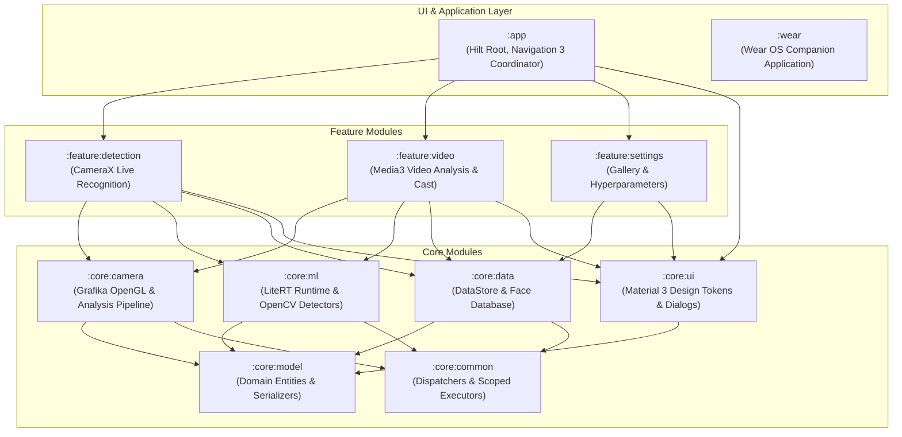

# FaceRecognition ⚡
### Enterprise On-Device Face Detection, Recognition & Vision Intelligence Platform for Android

[](https://github.com/cantricao/FaceRecognition/actions/workflows/ci.yml)
[](https://kotlinlang.org)
[](https://developer.android.com/studio/releases/gradle-plugin)
[](https://gradle.org)
[](https://developer.android.com)
[](https://developer.android.com/jetpack/compose)
[](https://developer.android.com/guide/navigation)
[](https://ai.google.dev/edge/litert)
[](LICENSE)

---

## 📌 Executive Summary

**FaceRecognition** is a modern, modular, production-ready enterprise Android platform designed for real-time edge computer vision, facial detection, identity embedding extraction, and multi-object tracking. Engineered from the ground up to follow **Clean Architecture** and strict reactive unidirectionality, the application delivers **sub-millisecond local inference with 100% data privacy**—zero video streams or biometric embeddings ever leave the physical device.

The platform natively adapts across the entire Android device ecosystem:
- 📱 **Smartphones & Foldables**: Responsive edge-to-edge UI with AndroidX Navigation 3 & Adaptive Navigation Suite.
- 💻 **Tablets & Desktop/ChromeOS**: Multi-pane navigation rails, hardware keyboard shortcuts, and pointer gestures.
- 🚗 **Android Automotive OS & Android Auto**: Parked application integration with `CarUxRestrictions` compliance.
- 📺 **Android TV**: Dedicated 10-foot hero layout using Jetpack Compose for TV.
- ⌚ **Wear OS**: Standalone companion application with Glance Wear widgets and `TransformingLazyColumn`.
- 🕶️ **Android XR / Smart Glasses**: Spatial camera overlays and projected display experiences via Compose Glimmer.

---

## 🏛️ Architecture & Modularization

The repository is organized into a highly scalable multi-module architecture:



### Module Responsibilities

| Module | Type | Description |
| :--- | :--- | :--- |
| [`:app`](file:///C:/Users/admin/FaceRecognition/app) | Application | Application entry point, Dagger Hilt dependency graph, Navigation 3 backstack coordinator, AppFunctions, Glance home widget, TV, and XR activities. |
| [`:feature:detection`](file:///C:/Users/admin/FaceRecognition/feature/detection) | Android Library | Camera preview screen, dynamic bounding box rendering, recognition states, and camera lifecycle coordination. |
| [`:feature:video`](file:///C:/Users/admin/FaceRecognition/feature/video) | Android Library | Video file analysis, Media3 ExoPlayer surface integration, Car-aware driving restrictions, and Google Cast playback. |
| [`:feature:settings`](file:///C:/Users/admin/FaceRecognition/feature/settings) | Android Library | Enrolled identity gallery management, threshold sliders, model selection, and dataset import/export. |
| [`:core:camera`](file:///C:/Users/admin/FaceRecognition/core/camera) | Android Library | CameraX pipeline, Grafika hardware OpenGL ES rendering (`EglCore`, `Texture2dProgram`), GLSL shaders, and `AnalysisViewModel`. |
| [`:core:ml`](file:///C:/Users/admin/FaceRecognition/core/ml) | Android Library | Google LiteRT runtime (`CompiledModel`), BlazeFace, MobileNet SSD, MobileFaceNet embedding extractor, and OpenCV YuNet. |
| [`:core:data`](file:///C:/Users/admin/FaceRecognition/core/data) | Android Library | Local persistence using DataStore Preferences and Room SQLite database with nearest-neighbor vector search. |
| [`:core:ui`](file:///C:/Users/admin/FaceRecognition/core/ui) | Android Library | Material 3 typography, color schemes, adaptive preview annotations, and runtime permission dialogs. |
| [`:core:model`](file:///C:/Users/admin/FaceRecognition/core/model) | Android Library | Pure Kotlin domain models (`Person`, `Recognition`, `TrackedRecognition`) and serialization handlers. |
| [`:core:common`](file:///C:/Users/admin/FaceRecognition/core/common) | Android Library | Shared coroutine dispatchers (`@IoDispatcher`, `@DefaultDispatcher`), tracing utilities, and scoped executors. |
| [`:wear`](file:///C:/Users/admin/FaceRecognition/wear) | Application | Standalone Wear OS app with Compose Material 3, rotary scroll inputs, and Remote Compose Glance widget. |

---

## ⚡ Edge Machine Learning & Vision Pipeline

1. **Detection**:
   - **BlazeFace (Front & Back)**: Sub-millisecond face bounding-box locator optimized for mobile front-facing lenses.
   - **OpenCV YuNet**: High-accuracy lightweight face detector with landmark estimation.
   - **MobileNet SSD**: General object detector supporting multi-class bounding box regression.
2. **Feature Extraction**:
   - **MobileFaceNet**: Generates compact 128-dimensional normalized floating-point embedding vectors.
   - **Vector Nearest Neighbor**: High-speed cosine and Euclidean distance matching with configurable cosine similarity threshold.
3. **LiteRT Runtime Acceleration**:
   - Bundled with `com.google.ai.edge.litert:2.3.0`.
   - Supports OpenCL/Vulkan GPU delegates with automatic graceful CPU fallback.
4. **On-Device Generative AI (Gemini Nano)**:
   - Deep integration with `mlkit.genai.prompt` and `mlkit.genai.agent` for local conversational querying of detected identities without network roundtrips.
   - **AppFunctions**: Standardized Android 16/17 schema declarations allowing Google Assistant and system AI agents to search or inspect registered profiles securely.

---

## 📱 Multi-Platform & Form-Factor Capabilities

- **Jetpack Navigation 3 & Predictive Back**:
  - Strongly-typed destination routing with `@Serializable` subclasses of `NavKey`.
  - Seamless predictive back animations using `androidx.navigationevent`.
  - Material 3 Adaptive Navigation Suite: renders a Bottom Navigation Bar on compact devices (phones) and dynamically elevates to a Navigation Rail on foldables and tablets.
- **Android Automotive OS / Cars**:
  - Parked video analytics that automatically pause and mute when vehicle gear state shifts out of park (`CarUxRestrictionsManager`).
- **Jetpack Glance Widgets**:
  - Home screen widget utilizing Canonical Layouts (`ImageTextListAppWidget`).
  - Wear OS home screen tiles using Glance Wear.
- **Play Integrity & Security**:
  - Zero broad storage permissions declared (`READ_EXTERNAL_STORAGE` / `WRITE_EXTERNAL_STORAGE` removed for API > 28).
  - Modern Android Photo Picker (`ActivityResultContracts.PickMultipleVisualMedia`) integration.
  - Google Credential Manager (Restore Credentials and Verified Email SD-JWT parser).

---

## 🧪 Testing Strategy & Quality Assurance

Automated testing is maintained across multiple complementary tiers:

```bash
# 1. Run all host JVM unit & Robolectric Compose tests across all modules
./gradlew testDebugUnitTest

# 2. Generate aggregated multi-module JaCoCo code coverage report
./gradlew jacocoRootReport

# 3. Validate Composable UI against golden screenshot references
./gradlew :app:validateDebugScreenshotTest

# 4. Update screenshot golden reference images
./gradlew :app:updateDebugScreenshotTest

# 5. Run static analysis with Detekt
./gradlew detekt

# 6. Execute instrumented end-to-end tests on connected emulator or hardware device
./gradlew connectedDebugAndroidTest
```

For full test architecture and mock harnesses, see the [Testing Strategy & Execution Guide](docs/testing.md).

---

## 🚀 Getting Started

### Prerequisites
- **Android Studio**: Ladybug (2024.2.1) or Meerkat+
- **JDK Target**: Java 17 (Eclipse Temurin or Android Studio JBR)
- **Android SDK Tools**:
  - Compile SDK: `37`
  - Min SDK: `24` (Wear OS: `26`)
  - NDK: `26.2.11394342`

### Building the Project

```bash
# Clone the repository
git clone https://github.com/cantricao/FaceRecognition.git
cd FaceRecognition

# Build debug APK and release App Bundle
./gradlew :app:assembleDebug :app:bundleRelease

# Build Wear OS companion application
./gradlew :wear:assembleDebug
```

---

## 🤝 Developer Guidelines & AI Pair Programming

For complete developer onboarding, agent rules, and branch conventions, review:
- 📖 [AGENTS.md](AGENTS.md)
- 📖 [docs/testing.md](docs/testing.md)

---

## 📄 License

```text
Copyright 2026 FaceRecognition Project Contributors

Licensed under the Apache License, Version 2.0 (the "License");
you may not use this file except in compliance with the License.
You may obtain a copy of the License at

    http://www.apache.org/licenses/LICENSE-2.0

Unless required by applicable law or agreed to in writing, software
distributed under the License is distributed on an "AS IS" BASIS,
WITHOUT WARRANTIES OR CONDITIONS OF ANY KIND, either express or implied.
See the License for the specific language governing permissions and
limitations under the License.
```
