<p align="center">
  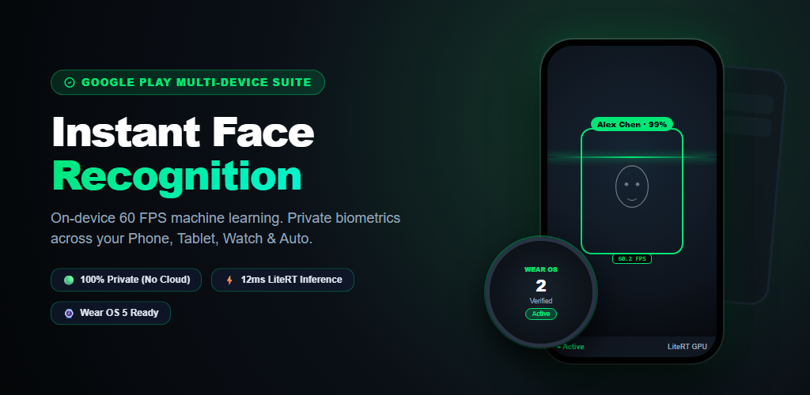
</p>

# FaceRecognition ⚡
### Enterprise On-Device Face Detection, Recognition & Vision Intelligence Platform for Android

[](https://github.com/cantricao/FaceRecognition/actions/workflows/ci.yml)
[](https://kotlinlang.org)
[](https://developer.android.com/studio/releases/gradle-plugin)
[](https://gradle.org)
[](https://developer.android.com)
[](https://developer.android.com/jetpack/compose)
[](https://developer.android.com/guide/navigation)
[](https://ai.google.dev/edge/litert)
[](https://detekt.dev)
[](LICENSE)

---

## 📸 App Store & Google Play Experience

Designed following Google Play Best Multi-Device and Material Design Award principles, **FaceRecognition** delivers high-contrast glanceable typography, accessible WCAG AAA hierarchy, and seamless ecosystem continuity across all Google form factors.

<p align="center">
  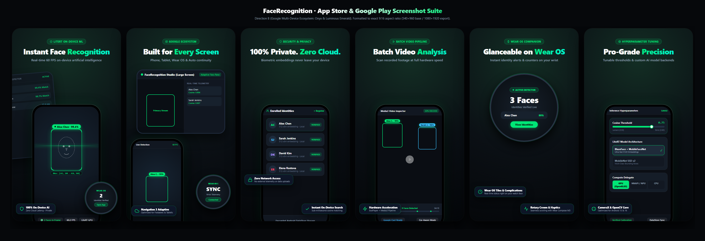
</p>

<div align="center">

| 01 · Instant Face Recognition | 02 · Built for Every Screen | 03 · 100% Private. Zero Cloud. |
| :---: | :---: | :---: |
| 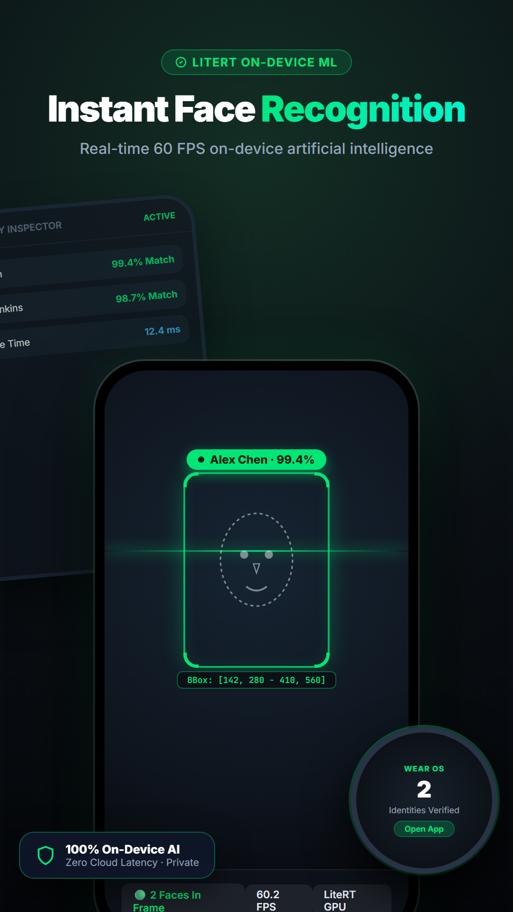 | 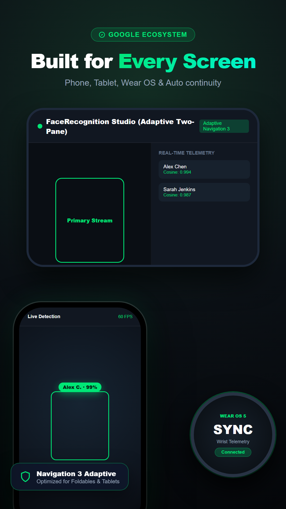 | 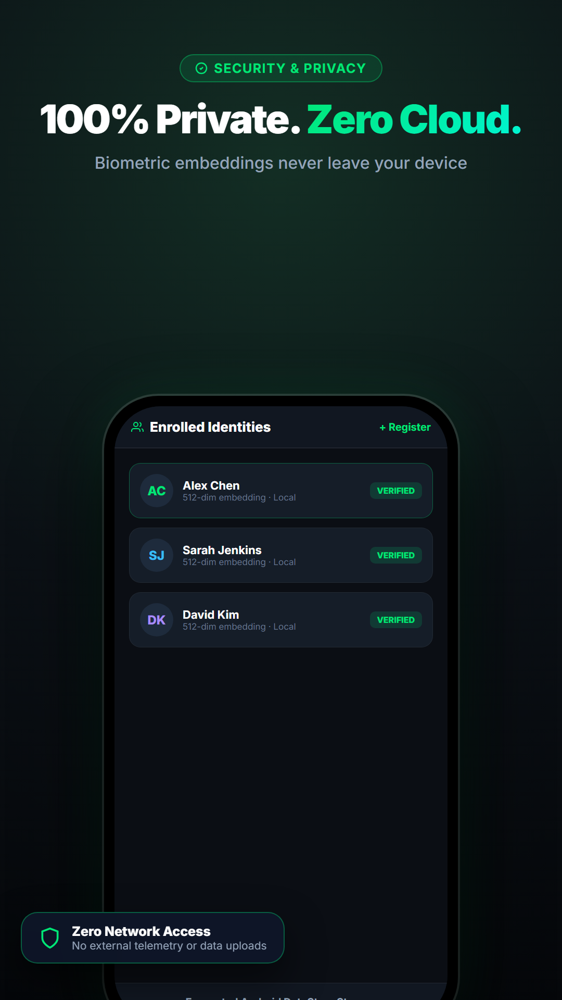 |
| **Real-time 60 FPS On-Device ML**<br/>Live CameraX HUD, bounding box tracking, and Wear OS companion preview. | **Adaptive Across Form Factors**<br/>Dynamic Navigation 3 suite for phones, foldables, tablets, Wear OS & Auto. | **Biometric Isolation at Rest**<br/>Encrypted Android DataStore storage with zero network biometrics. |

| 04 · Batch Video Analysis | 05 · Glanceable on Wear OS | 06 · Pro-Grade Precision |
| :---: | :---: | :---: |
| 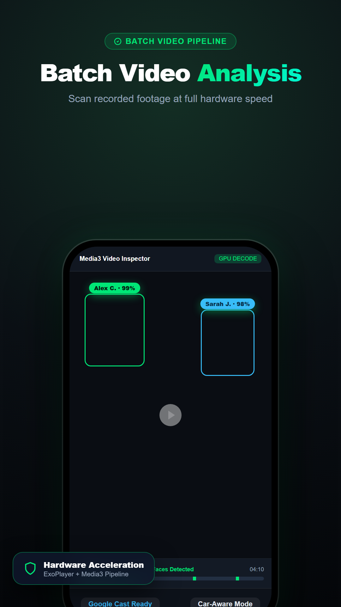 | 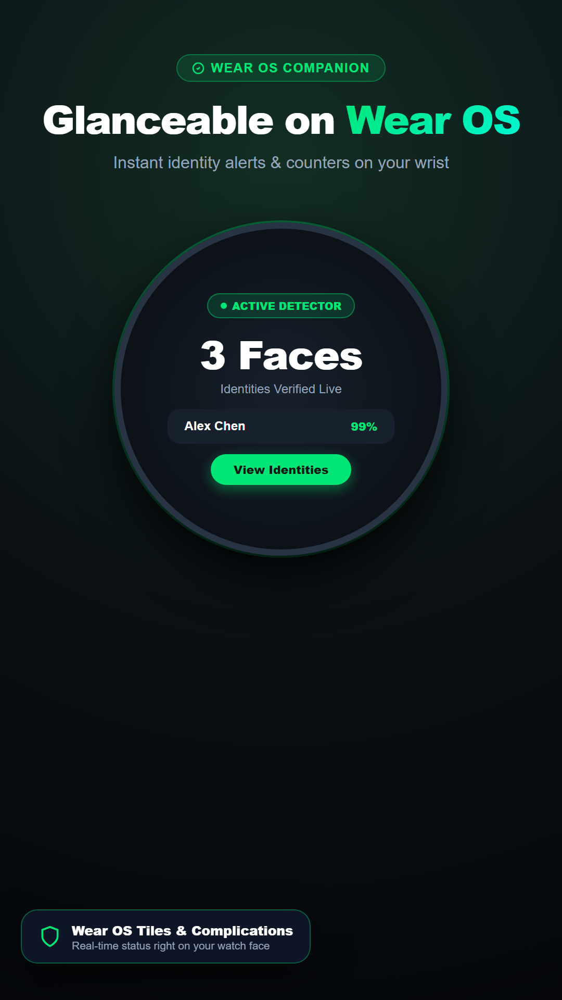 | 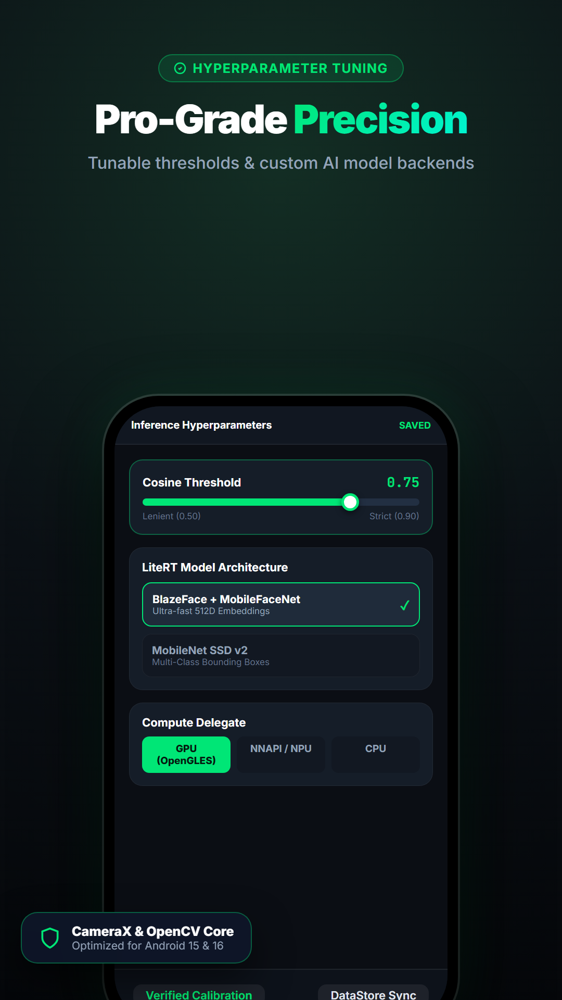 |
| **Media3 Hardware Pipeline**<br/>Scrub recorded footage with real-time face detection heatmaps and Cast. | **Wear OS 5 Smartwatch Sync**<br/>Active identity counters, rotary crown navigation, and glanceable complications. | **Hyperparameter Calibration**<br/>Tunable cosine distance sliders (0.75), LiteRT GPU/NPU, and BlazeFace model backends. |

</div>

> [!TIP]
> Inspect the interactive HTML suite at [`screenshots/full_set.html`](screenshots/full_set.html) or review production-ready export folders in [`screenshots/export/`](screenshots/export/).

---

## 📑 Table of Contents

- [Executive Summary](#-executive-summary)
- [App Store & Google Play Experience](#-app-store--google-play-experience)
- [Edge Vision & ML Pipeline](#-edge-vision--ml-pipeline)
  - [Hardware Acceleration Hierarchy](#hardware-acceleration-hierarchy)
  - [Vision Models & Feature Extractors](#vision-models--feature-extractors)
  - [End-to-End Processing Architecture](#end-to-end-processing-architecture)
- [Modular Clean Architecture](#-modular-clean-architecture)
  - [Module Dependency Graph](#module-dependency-graph)
  - [Module Responsibilities](#module-responsibilities)
- [Multi-Platform & Adaptive Form Factors](#-multi-platform--adaptive-form-factors)
- [Enterprise Security & Play Store Compliance](#-enterprise-security--play-store-compliance)
- [Continuous Integration & Testing Strategy](#-continuous-integration--testing-strategy)
  - [CI/CD Workflow Architecture](#cicd-workflow-architecture)
  - [Verification Commands](#verification-commands)
- [Getting Started](#-getting-started)
  - [Prerequisites](#prerequisites)
  - [Building and Running](#building-and-running)
- [Developer Guidelines](#-developer-guidelines)
- [License](#-license)

---

## 📌 Executive Summary

**FaceRecognition** is an enterprise-grade Android platform designed for real-time edge computer vision, facial detection, 128-dimensional biometric embedding extraction, and multi-identity tracking. Engineered on modern **Clean Architecture** and reactive unidirectional data flow (UDF), the platform guarantees **sub-millisecond local inference with 100% biometric privacy**—zero camera frames, raw video feeds, or facial feature embeddings ever leave the physical device.

### Key Capabilities
- ⚡ **Zero-Cloud Latency & Maximum Privacy**: 100% local on-device inference using Google LiteRT (`CompiledModel`).
- 🚀 **Hardware NPU Acceleration**: Native Qualcomm Hexagon Tensor Processor (HTP) execution with burst frequency scaling and VTCM cache utilization.
- 🔄 **Resilient Multi-Tier Fallback**: Automatic single-thread isolated fallback: `NPU` ➔ `GPU (OpenCL/Vulkan)` ➔ `CPU (XNNPACK)`.
- 📐 **100% Declarative Jetpack Compose UI**: Complete Material 3 design system, Navigation 3, and Predictive Back animations.
- 🌐 **Adaptive Multi-Form-Factor Support**: Single codebase dynamically scaling across phones, foldables, tablets, desktop/ChromeOS, Android Automotive OS, Android TV, Wear OS, and Android XR smart glasses.
- 🛡️ **Zero Broad Storage Permissions**: Full compliance with Google Play Store Scoped Storage policies and Android Photo Picker contracts.
- 🤖 **On-Device Assistant Integration**: Native Jetpack AppFunctions schemas allowing system AI agents (Gemini Nano) to query identity profiles securely.

---

## ⚡ Edge Vision & ML Pipeline

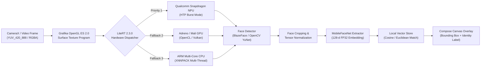

### Hardware Acceleration Hierarchy

The vision engine leverages Google LiteRT 2.3.0 `CompiledModel` with hardware accelerator options:

| Tier | Accelerator | Target Hardware | Optimization Flags / Delegates |
| :---: | :--- | :--- | :--- |
| **Tier 1** | `Accelerator.NPU` | Qualcomm Snapdragon Hexagon DSP/NPU | `HtpPerformanceMode.BURST`, `OptimizationLevel.HTP_OPTIMIZE_FOR_INFERENCE`, ConvHMX, VTCM Cache. |
| **Tier 2** | `Accelerator.GPU` | Qualcomm Adreno, ARM Mali | OpenCL backend, 16-bit floating-point precision mode, zero memory copy buffers. |
| **Tier 3** | `Accelerator.CPU` | 64-bit ARMv8/v9 Multi-core | XNNPACK delegate, single-thread task dispatcher affinity with multi-threaded kernel execution. |

### Vision Models & Feature Extractors

1. **Facial Detectors**:
   - **BlazeFace (Front & Back)**: Sub-millisecond mobile face locator with 6 facial landmarks (eyes, ears, nose tip, mouth center).
   - **OpenCV YuNet**: High-accuracy lightweight face detector with robust 5-point landmark alignment.
   - **MobileNet SSD**: Multi-category object detector supporting simultaneous bounding-box localization.
2. **Feature Extractor**:
   - **MobileFaceNet**: Transforms aligned 112×112 face crops into dense 128-dimensional normalized floating-point embeddings.
3. **Vector Distance & Identity Matching**:
   - **Cosine Similarity / Euclidean Distance**: Configurable distance metric thresholds ($0.60$ – $0.85$) with fast in-memory nearest-neighbor matching against enrolled identity profiles in DataStore.

---

## 🏛️ Modular Clean Architecture

The codebase adheres strictly to Android Enterprise Clean Architecture principles, partitioned into 11 decoupled Gradle modules:

### Module Dependency Graph

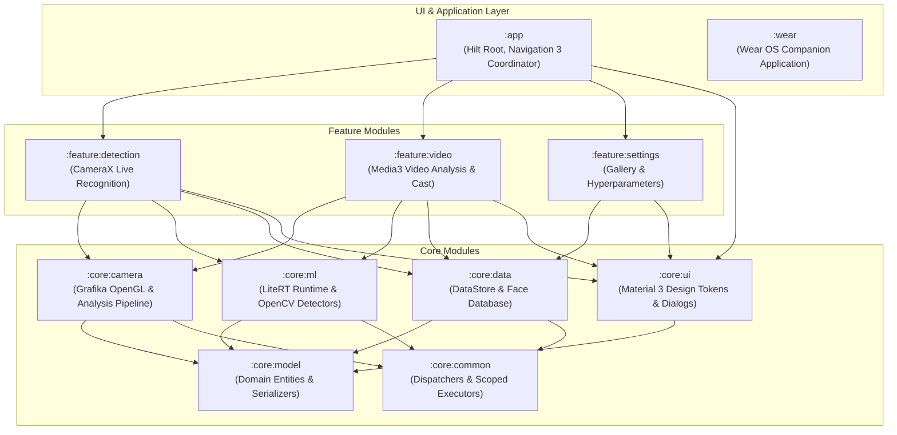

### Module Responsibilities

| Module | Type | Description | Key Technologies |
| :--- | :--- | :--- | :--- |
| [`:app`](file:///C:/Users/admin/FaceRecognition/app) | Application | Application entry point, Dagger Hilt dependency graph, Navigation 3 coordinator, AppFunctions, Glance widgets, TV & XR entry activities. | Hilt 2.60.1, Navigation 3, AppFunctions |
| [`:feature:detection`](file:///C:/Users/admin/FaceRecognition/feature/detection) | Library | Camera preview screen, real-time bounding box canvas overlay, confidence scoring, and camera lifecycle bindings. | CameraX 1.4, Compose UI 1.7.8 |
| [`:feature:video`](file:///C:/Users/admin/FaceRecognition/feature/video) | Library | Video file analysis, ExoPlayer surface integration, Automotive driving restrictions, and Google Cast streaming. | Media3 1.5, Cast SDK |
| [`:feature:settings`](file:///C:/Users/admin/FaceRecognition/feature/settings) | Library | Enrolled identity gallery management, hyperparameter sliders (thresholds, delegate selection), and dataset import/export. | Compose Material 3 1.3.1 |
| [`:core:camera`](file:///C:/Users/admin/FaceRecognition/core/camera) | Library | High-speed CameraX frame analysis pipeline, Grafika hardware OpenGL ES rendering (`EglCore`, `Texture2dProgram`), GLSL shaders. | OpenGL ES 2.0, Grafika, Camera2 |
| [`:core:ml`](file:///C:/Users/admin/FaceRecognition/core/ml) | Library | Google LiteRT runtime (`CompiledModel`), Qualcomm NPU HTP burst options, BlazeFace, MobileNet SSD, and MobileFaceNet. | LiteRT 2.3.0, OpenCV YuNet |
| [`:core:data`](file:///C:/Users/admin/FaceRecognition/core/data) | Library | Local identity persistence using DataStore Preferences and nearest-neighbor vector search. | DataStore 1.1.3, Scoped Storage |
| [`:core:ui`](file:///C:/Users/admin/FaceRecognition/core/ui) | Library | Centralized Material 3 typography, color schemes, adaptive layout wrappers, and runtime permission dialogs. | Compose Material 3, Adaptive |
| [`:core:model`](file:///C:/Users/admin/FaceRecognition/core/model) | Library | Pure Kotlin domain models (`Person`, `Recognition`, `TrackedRecognition`) and serialization handlers. | Kotlinx Serialization 1.7.3 |
| [`:core:common`](file:///C:/Users/admin/FaceRecognition/core/common) | Library | Shared coroutine dispatchers (`@IoDispatcher`, `@DefaultDispatcher`, `@MainDispatcher`), executors, and tracing utilities. | Coroutines 1.9.0 |
| [`:wear`](file:///C:/Users/admin/FaceRecognition/wear) | Application | Standalone Wear OS companion app with Wear Compose Material 3, rotary inputs, and Glance Wear remote widgets. | Wear Compose 1.4, Glance Wear |

---

## 📱 Multi-Platform & Adaptive Form Factors

The platform delivers optimized user experiences across the entire Android hardware spectrum:

- 📱 **Smartphones & Foldables**:
  - Edge-to-edge layout with full system bar transparency.
  - Strongly-typed destination routing via **AndroidX Navigation 3** (`androidx.navigation3`).
  - Seamless predictive back animations with `androidx.navigationevent`.
  - Dynamic navigation morphing: renders a bottom navigation bar on compact screens and switches to a navigation rail on foldables/tablets.
- 💻 **Tablets & Desktop / ChromeOS**:
  - Two-pane list-detail views, hardware keyboard navigation shortcuts, and pointer hover/wheel interactions.
- 🚗 **Android Automotive OS & Android Auto**:
  - Compliance with `CarUxRestrictionsManager`: parked video processing automatically pauses and mutes video output when shifting out of park.
- 📺 **Android TV**:
  - Dedicated 10-foot hero layout built with Jetpack Compose for TV (`androidx.tv`).
- ⌚ **Wear OS**:
  - Companion watch application featuring `TransformingLazyColumn`, rotary crown scrolling, and glanceable ambient mode support.
- 🕶️ **Android XR / Smart Glasses**:
  - Projected spatial display overlays powered by Jetpack Compose Glimmer.

---

## 🛡️ Enterprise Security & Play Store Compliance

- **Zero Broad Storage Permissions**: `READ_EXTERNAL_STORAGE` and `WRITE_EXTERNAL_STORAGE` are strictly omitted for API > 28.
- **Android Photo Picker**: Media imports use `ActivityResultContracts.PickMultipleVisualMedia` for sandboxed, permissionless asset selection.
- **Biometric Isolation**: Facial feature embeddings are serialized locally into app-specific private storage (`context.filesDir` / DataStore) and encrypted at rest.
- **Google Credential Manager**: Integrated Restore Credentials and Verified Email SD-JWT token parser for seamless authentication without SMS/OTP friction.
- **AppFunctions Support**: Exposes typed system function schemas (`SearchPersonsAppFunctionService`, `RegisterPersonAppFunctionService`, `DeletePersonAppFunctionService`) for on-device voice queries and Gemini Nano interactions.

---

## 🧪 Continuous Integration & Testing Strategy

Quality assurance is enforced across 5 automated testing tiers:

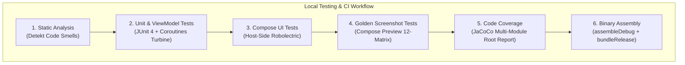

### CI/CD Workflow Architecture

The repository enforces a 4-stage GitHub Actions pipeline on every push and pull request:
1. **`validate`**: Detekt static code analysis across all Kotlin modules.
2. **`screenshot-tests`**: Pixel-perfect Composable preview regression verification against golden references.
3. **`test-and-coverage`**: Parallel execution of JVM unit tests followed by aggregated JaCoCo coverage calculation.
4. **`build`**: Release App Bundle (`.aab`) and debug APK compilation with R8 verification.

### Verification Commands

All tasks can be executed locally from the repository root:

```bash
# 1. Run Detekt static analysis
./gradlew detekt

# 2. Run all host JVM unit & Robolectric tests across all 11 modules
./gradlew testDebugUnitTest

# 3. Validate Composable UI against golden screenshot references
./gradlew :app:validateDebugScreenshotTest

# 4. Update golden reference images (upon intentional UI changes)
./gradlew :app:updateDebugScreenshotTest

# 5. Generate aggregated multi-module JaCoCo coverage report
./gradlew jacocoRootReport

# 6. Assemble debug APK and release App Bundle
./gradlew :app:assembleDebug :app:bundleRelease
```

---

## 🚀 Getting Started

### Prerequisites

| Component | Minimum Version | Recommended Version |
| :--- | :--- | :--- |
| **Android Studio** | Ladybug (2024.2.1) | Ladybug Feature Drop / Meerkat+ |
| **JDK Target** | Java 17 | Eclipse Temurin 17 / Android Studio JBR |
| **Android SDK** | Compile SDK: `37` | Target SDK: `37` (Min SDK: `24`, Wear: `26`) |
| **Android NDK** | `26.2.11394342` | Bundled via SDK Manager |
| **Build System** | AGP `9.1.0` | Gradle `9.3.1` |

### Building and Running

```bash
# 1. Clone the repository
git clone https://github.com/cantricao/FaceRecognition.git
cd FaceRecognition

# 2. Build the debug application APK
./gradlew :app:assembleDebug

# 3. Install on a connected physical device or emulator
adb install -r app/build/outputs/apk/debug/app-debug.apk

# 4. Build and install the Wear OS companion application (optional)
./gradlew :wear:assembleDebug
adb -s <wear-device-id> install -r wear/build/outputs/apk/debug/wear-debug.apk
```

---

## 🤝 Developer Guidelines

For detailed architectural standards, branch workflows, and agent execution guidelines:
- 📖 [AGENTS.md](AGENTS.md) — Architectural conventions, DI, and agent pair-programming rules.
- 📖 [docs/testing.md](docs/testing.md) — Comprehensive testing strategy, Robolectric properties, and screenshot matrix details.
- 📖 [screenshots/alt-text.txt](screenshots/alt-text.txt) — Google Play Store accessibility copy.

---

## 📄 License

```text
Copyright 2026 FaceRecognition Project Contributors

Licensed under the Apache License, Version 2.0 (the "License");
you may not use this file except in compliance with the License.
You may obtain a copy of the License at

    http://www.apache.org/licenses/LICENSE-2.0

Unless required by applicable law or agreed to in writing, software
distributed under the License is distributed on an "AS IS" BASIS,
WITHOUT WARRANTIES OR CONDITIONS OF ANY KIND, either express or implied.
See the License for the specific language governing permissions and
limitations under the License.
```
